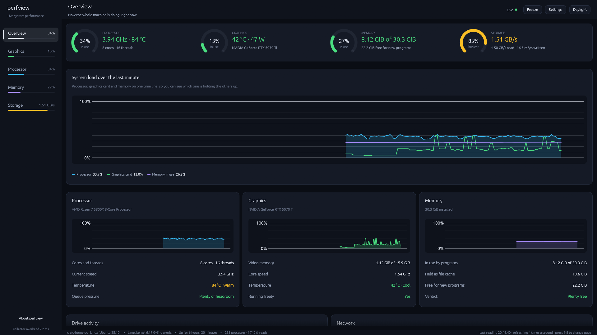
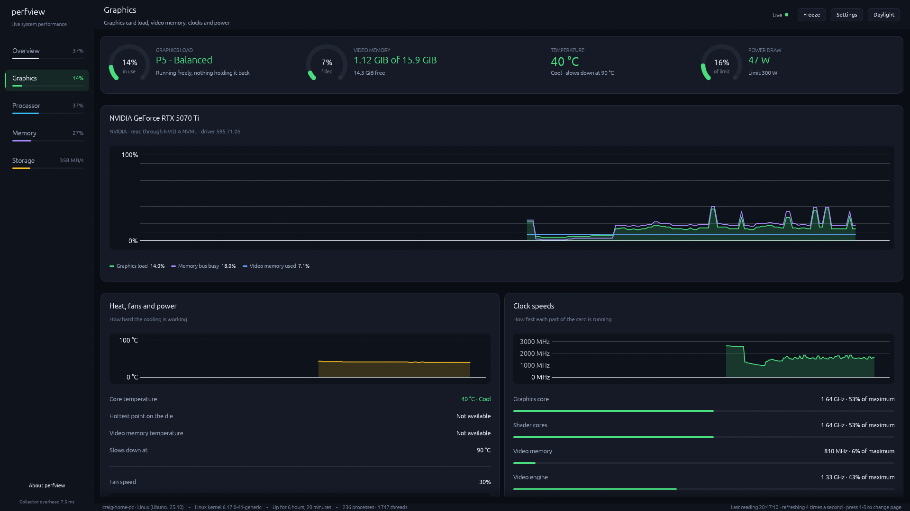
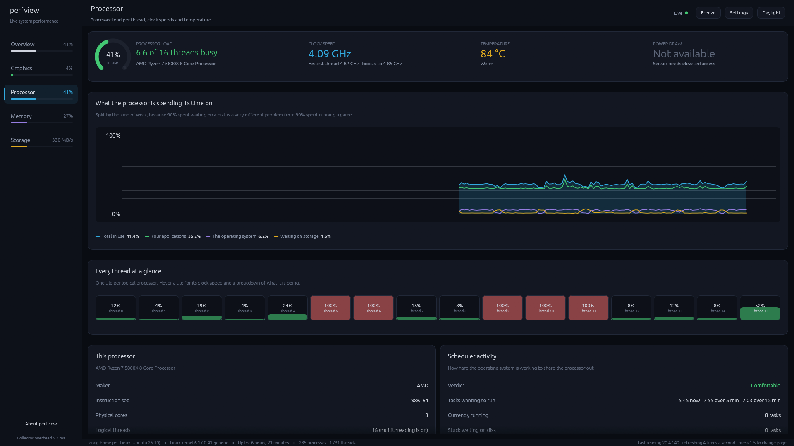
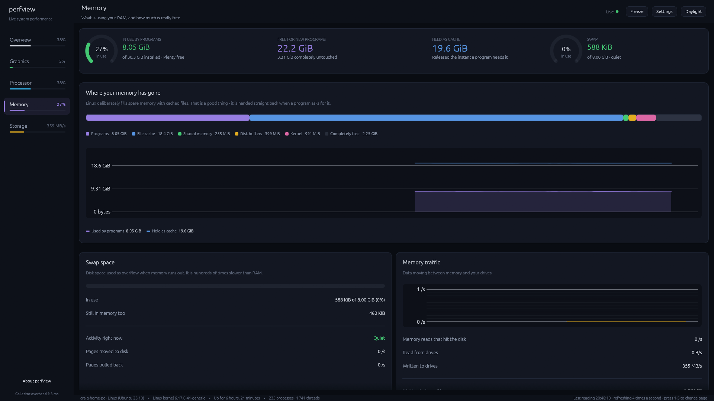
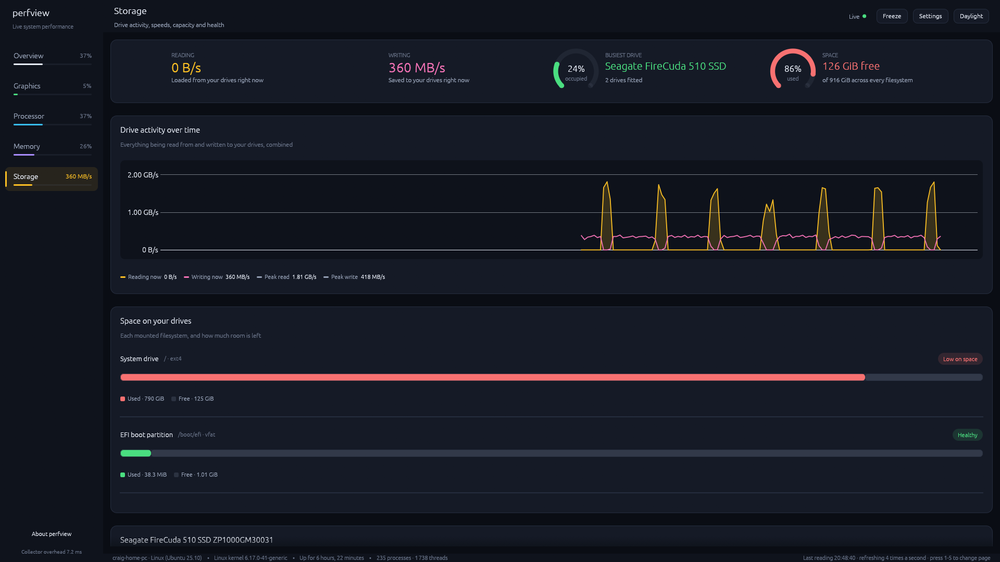

<div align="center">

# perfview

A live system performance viewer for Linux.

[](https://github.com/crxig-rxberts/perfview/actions/workflows/ci.yml)
[](LICENSE)
[](https://www.rust-lang.org)
[](#requirements)

<br />



</div>

---

perfview reports processor, graphics, memory, storage and network activity in
real time, across five pages. Readings are labelled in full sentences and
converted to familiar units, and each one has a hover hint describing what it
measures. Sensors that cannot be read are reported as unavailable rather than
shown as zero.

It is a graphical application built with [egui](https://github.com/emilk/egui),
and ships as a single binary that depends only on libc.

## Contents

- [Features](#features)
- [Screenshots](#screenshots)
- [Installation](#installation)
- [Usage](#usage)
- [Pages](#pages)
- [Requirements](#requirements)
- [Performance](#performance)
- [Project layout](#project-layout)
- [Troubleshooting](#troubleshooting)
- [Contributing](#contributing)
- [Licence](#licence)

## Features

- Five pages: Overview, Graphics, Processor, Memory and Storage.
- Live area charts with a configurable window of 30 seconds to 15 minutes.
  Hovering a chart reads out the value and how long ago it was recorded.
- NVIDIA cards are read through NVML, giving per-process video memory, PCIe
  throughput, encoder and decoder load, clock domains, power limits and the
  driver's reported throttle reasons.
- AMD and Intel graphics are read through the kernel's `amdgpu` and `i915`
  sysfs interfaces.
- Per-thread processor load, split by user, kernel and I/O wait time.
- Memory broken down into programs, file cache, shared memory, disk buffers,
  kernel structures and free.
- Per-drive throughput, IOPS, utilisation, queue depth, latency and temperature,
  plus capacity for each mounted filesystem.
- Process tables ranked by processor, memory or disk activity.
- Dark and light themes, adjustable interface scale, and a freeze control.
- Sampling runs on a background thread. The window repaints only when new data
  arrives.
- No network access, no telemetry, no root required, and `unsafe` code is
  forbidden at the crate level.

## Screenshots

### Overview

Headline figures for each subsystem, a combined load chart, per-component
summaries, drive and network activity, and the busiest processes.


### Graphics

Load, video memory, clock domains, thermals, power, PCIe link state and
throughput, the driver's throttle reasons, and the processes holding video
memory.



### Processor

Load broken down by the kind of work, a tile per logical processor, clock
speeds, temperature sensors, cache sizes and scheduler counters.



### Memory

Composition of physical memory, swap usage and activity, page fault and
writeback rates, commit accounting, and installed memory modules.



### Storage

Combined and per-drive throughput, utilisation, queue depth, latency, drive
details and filesystem capacity.



## Installation

### Release builds

Download from the [releases page](https://github.com/crxig-rxberts/perfview/releases).
Each asset is published with a `.sha256` checksum.

```bash
# Debian, Ubuntu and derivatives
curl -LO https://github.com/crxig-rxberts/perfview/releases/latest/download/perfview_0.1.0_amd64.deb
sudo apt install ./perfview_0.1.0_amd64.deb

# Portable tarball
curl -L https://github.com/crxig-rxberts/perfview/releases/latest/download/perfview-0.1.0-x86_64-unknown-linux-gnu.tar.gz | tar xz
sudo install -m 755 perfview-*/perfview /usr/local/bin/
```

### Cargo

```bash
cargo install perfview --locked
```

### From source

```bash
git clone https://github.com/crxig-rxberts/perfview.git
cd perfview
cargo build --release
./target/release/perfview
```

Build dependencies are listed under [Requirements](#requirements).

## Usage

```bash
perfview
```

### Keyboard

| Key | Action |
| --- | --- |
| <kbd>1</kbd> – <kbd>5</kbd> | Switch to Overview, Graphics, Processor, Memory or Storage |
| <kbd>Space</kbd> | Freeze or resume sampling |

### Command line

```text
Usage: perfview [OPTIONS]

Options:
      --page <PAGE>             Page to open on startup [default: overview]
                                [possible values: overview, gpu, cpu, memory, storage]
      --refresh <MILLISECONDS>  Milliseconds between readings [default: 1000]
      --history <SECONDS>       Seconds of history kept in every graph [default: 60]
      --theme <THEME>           Colour theme [default: midnight]
                                [possible values: midnight, daylight]
      --scale <FACTOR>          Interface scale, where 1.0 is 100% [default: 1]
      --size <WxH>              Window size on startup, e.g. 1600x1000
      --fresh                   Ignore saved preferences and use these values
  -h, --help                    Print help
  -V, --version                 Print version
```

Examples:

```bash
# Four readings a second, opening on the Graphics page
perfview --fresh --page gpu --refresh 250 --size 1600x1000

# Long-term watching with a 15-minute chart window
perfview --fresh --refresh 5000 --history 900

# Light theme at 125% scale
perfview --fresh --theme daylight --scale 1.25
```

Settings changed in the application are saved and restored on the next run.
`--fresh` ignores them.

## Pages

<details>
<summary>Overview</summary>

- Headline figures for processor, graphics, memory and storage
- Combined load chart for processor, graphics and memory
- Per-component summary cards with sparklines
- Drive throughput and per-filesystem free space
- Network throughput, link speeds and per-interface totals
- Processes ranked by processor time

</details>

<details>
<summary>Graphics</summary>

- Graphics load, memory bus load, encoder and decoder load
- Video memory used, free and total
- BAR1 window size and usage
- Core, shader, memory and video engine clocks against their maxima
- Core, hotspot and memory temperatures, and the slowdown threshold
- Fan speed as a percentage and in RPM
- Board power against the enforced limit
- PCIe generation, width, theoretical bandwidth and live throughput in both
  directions, flagged when the link is below its maximum
- Throttle reasons reported by the driver, written out in full
- Driver performance state
- Processes holding video memory

</details>

<details>
<summary>Processor</summary>

- Load split into user, kernel and I/O wait time
- A tile per logical processor, with per-thread clock speed on hover
- Average, peak and maximum clock speeds
- Every readable package temperature sensor, with vendor labels translated
  (`Tctl` is shown as "Package (control)", `Tccd1` as "Core cluster 1")
- Package power draw where the sensor is readable
- Core and thread counts, SMT status, instruction set and cache sizes
- Load average compared against the thread count
- Context switches, interrupts and process creations per second
- Running and I/O-blocked task counts
- Scaling governor and driver

</details>

<details>
<summary>Memory</summary>

- Composition bar covering programs, file cache, shared memory, disk buffers,
  kernel structures and free memory
- Used against available, and the difference between them
- Swap usage, swap-in and swap-out rates, and compressed swap where configured
- Major page fault rate
- Page-in and page-out rates, dirty pages and writeback
- Committed memory against the kernel's commit limit
- Huge pages where configured
- Installed memory modules: slot, size, type and speed
- Processes ranked by resident memory

</details>

<details>
<summary>Storage</summary>

- Combined read and write throughput, with peaks
- Every mounted filesystem with a capacity bar, flagged above 90% full
- Per drive: throughput, IOPS, utilisation and queue depth
- Average read and write service time
- Drive temperature
- Model, firmware, capacity in decimal and binary units, and block size
- The active I/O scheduler
- Processes ranked by disk throughput

</details>

## Requirements

### Running

- Linux on x86-64 or ARM64
- An X11 or Wayland session with OpenGL 3.3 or newer

No root access is required. Two readings are root-only on most distributions —
the processor's RAPL energy counter and the per-module memory details from DMI —
and are reported as unavailable when running as a normal user.

NVIDIA telemetry requires the proprietary driver. NVML is loaded at runtime, so
the same binary runs on machines without it and falls back to the kernel's
generic interface. AMD and Intel graphics work without additional drivers.

### Building

```bash
# Debian, Ubuntu and derivatives
sudo apt install build-essential libgtk-3-dev libxcb-render0-dev \
  libxcb-shape0-dev libxcb-xfixes0-dev libxkbcommon-dev libssl-dev

# Fedora
sudo dnf install gcc gtk3-devel libxcb-devel libxkbcommon-devel openssl-devel

# Arch
sudo pacman -S base-devel gtk3 libxcb libxkbcommon openssl
```

Minimum supported Rust version is 1.90, checked in CI.

## Performance

Sampling cost is measured by an example in the repository:

```text
$ cargo run --release --example profile

Collector cost per sample, averaged over 4 rounds

  Processor         0.74 ms
  Memory            0.11 ms
  Filesystems       0.00 ms
  Drives            0.24 ms
  Network           0.23 ms
  Graphics          7.70 ms
  Processes        20.60 ms   (runs at most once a second)
```

Measured on a Ryzen 7 5800X with an RTX 5070 Ti and roughly 230 running
processes. The live figure is also shown in the bottom-left corner of the
application.

Notes on how that cost is kept down:

- Sampling runs on a background thread, so a slow sysfs read cannot delay a
  frame.
- `nvmlDeviceGetPcieThroughput` blocks for around 20 ms per direction while the
  driver samples the bus. It runs on a separate thread and the main sampler uses
  the most recent value.
- Per-device static values such as the card name, VBIOS version and maximum
  clocks are read once.
- Process enumeration passes `without_tasks` to sysinfo, which otherwise walks
  every thread of every process.
- Thread counts are parsed from `/proc/<pid>/stat` rather than scanning
  `/proc/<pid>/task`.
- Network counters are read from `/proc/net/dev` in a single read rather than
  eight sysfs reads per interface.
- Mount points and free space are refreshed every three seconds rather than
  every sample.
- The window repaints only when a new sample arrives.

## Project layout

```text
src/
├── main.rs              Command line, window setup, generated application icon
├── app.rs               Window chrome, navigation, settings, frame loop
├── metrics/             Data collection. No knowledge of the UI.
│   ├── collector.rs     Background sampling thread
│   ├── cpu.rs           /proc/stat, cpufreq, hwmon, RAPL
│   ├── memory.rs        /proc/meminfo, /proc/vmstat, DMI
│   ├── gpu.rs           NVML, with an amdgpu/i915 sysfs fallback
│   ├── storage.rs       /proc/diskstats, /sys/block, mount points
│   ├── network.rs       /proc/net/dev, /sys/class/net
│   ├── process.rs       Per-process figures via sysinfo
│   ├── history.rs       Rolling buffers behind every chart
│   └── sysfs.rs         Helpers for reading /proc and /sys
└── ui/                  Presentation. No knowledge of sysfs.
    ├── format.rs        Unit conversion and wording
    ├── theme.rs         Palette, spacing scale and egui style
    ├── widgets.rs       Gauges, charts, bars, the per-thread grid
    └── tabs/            One module per page
```

`metrics` stores values in raw units — bytes, hertz, watts, degrees Celsius —
and performs no formatting. `ui` reads no files. All unit conversion and wording
lives in `src/ui/format.rs`.

Built with [egui](https://github.com/emilk/egui) and
[eframe](https://github.com/emilk/egui/tree/master/crates/eframe),
[sysinfo](https://github.com/GuillaumeGomez/sysinfo) and
[nvml-wrapper](https://github.com/Cldfire/nvml-wrapper).

## Troubleshooting

<details>
<summary>The Graphics page reports no readable card</summary>

The notice at the top of the page states the reason. Common causes:

- No NVIDIA driver installed. perfview falls back to the kernel interface, which
  covers AMD and Intel.
- Running in a container or sandbox without `/sys` or the NVIDIA device nodes.
- Running as a different user from the one that owns the display.

</details>

<details>
<summary>Processor power draw is unavailable</summary>

`/sys/class/powercap/.../energy_uj` is root-only on most distributions. perfview
does not request elevated privileges, so the reading is reported as unavailable.

To grant access:

```bash
sudo chmod +r /sys/class/powercap/intel-rapl:0/energy_uj
```

On AMD systems the `zenpower` module exposes package power through `hwmon`,
which perfview reads automatically.

</details>

<details>
<summary>Memory modules are not listed</summary>

Module details come from DMI at `/sys/firmware/dmi/entries`, which is root-only.
The rest of the Memory page does not depend on it.

</details>

<details>
<summary>Temperatures are missing</summary>

Load the sensor module for the processor:

```bash
sudo modprobe k10temp    # AMD
sudo modprobe coretemp   # Intel
```

</details>

<details>
<summary>The window does not open</summary>

perfview requires OpenGL 3.3.

```bash
glxinfo | grep "OpenGL version"
RUST_LOG=perfview=debug,eframe=debug perfview
```

</details>

## Contributing

See [CONTRIBUTING.md](CONTRIBUTING.md) for build setup, project conventions and
how to add a new reading. Bug reports are useful even without a fix, since
perfview can only be tested against hardware its contributors own.

See also the [Code of Conduct](CODE_OF_CONDUCT.md) and the
[Security policy](SECURITY.md).

## Licence

[MIT](LICENSE) © Craig Roberts
